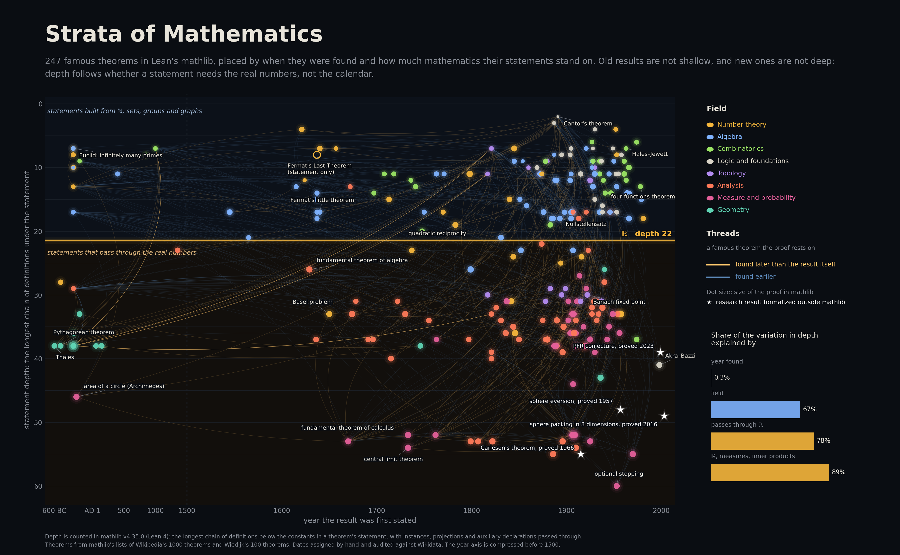
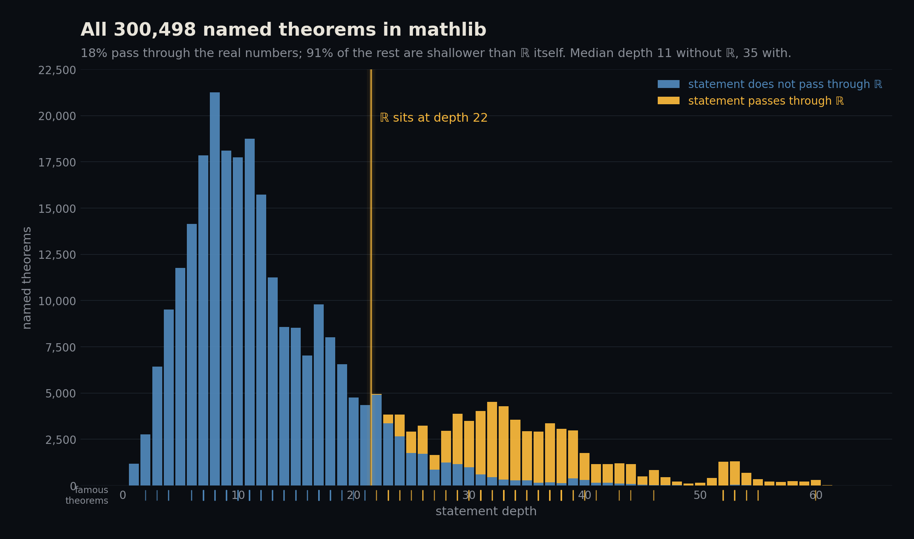
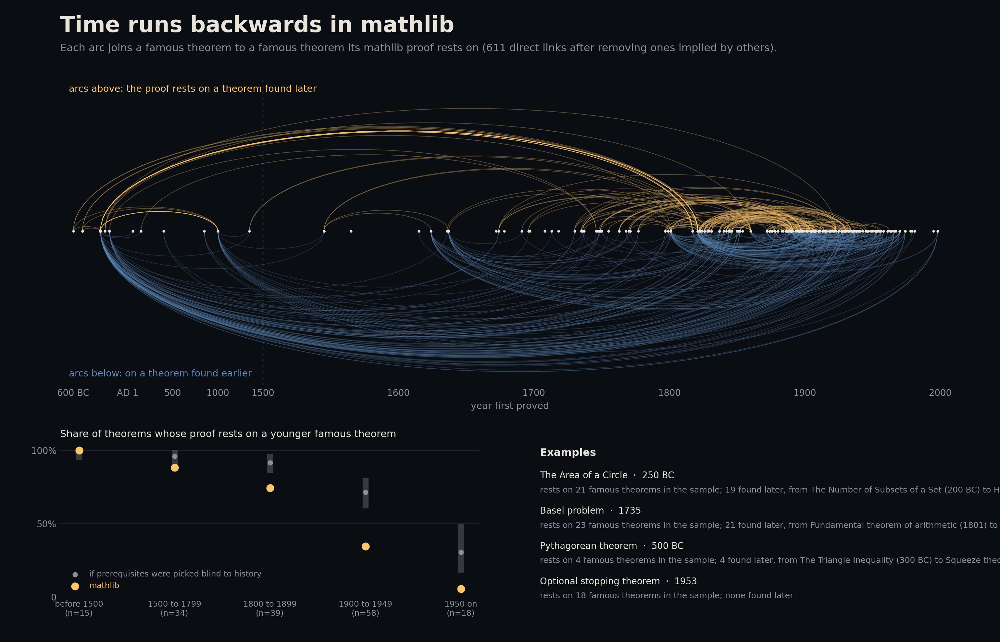
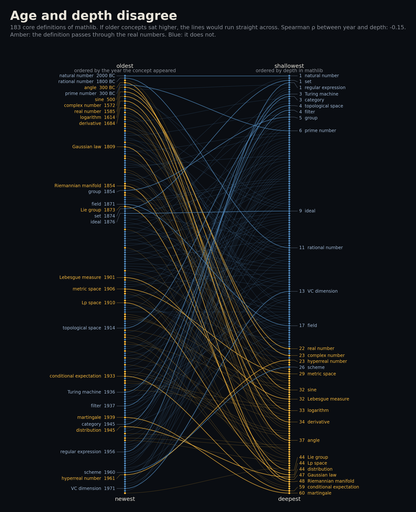
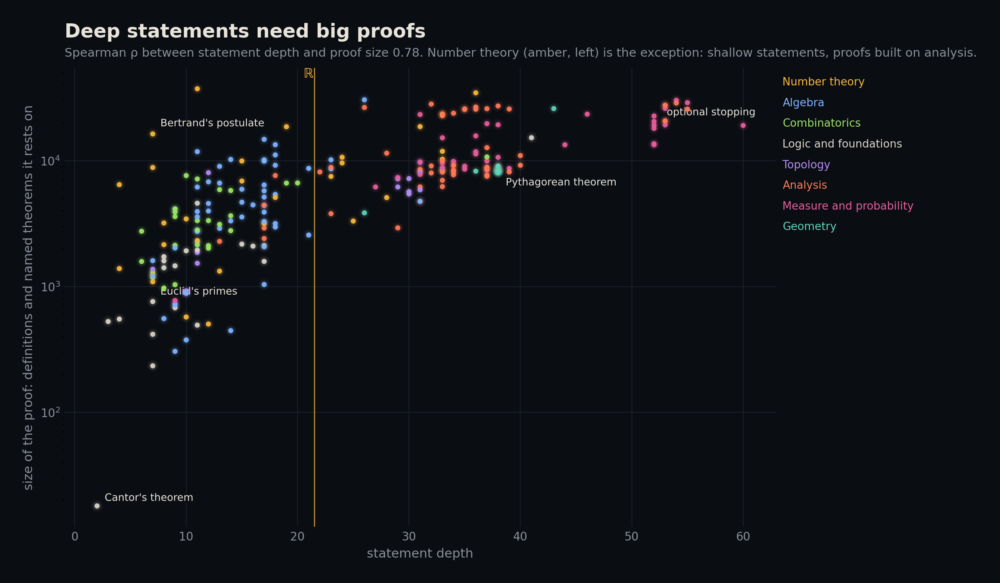
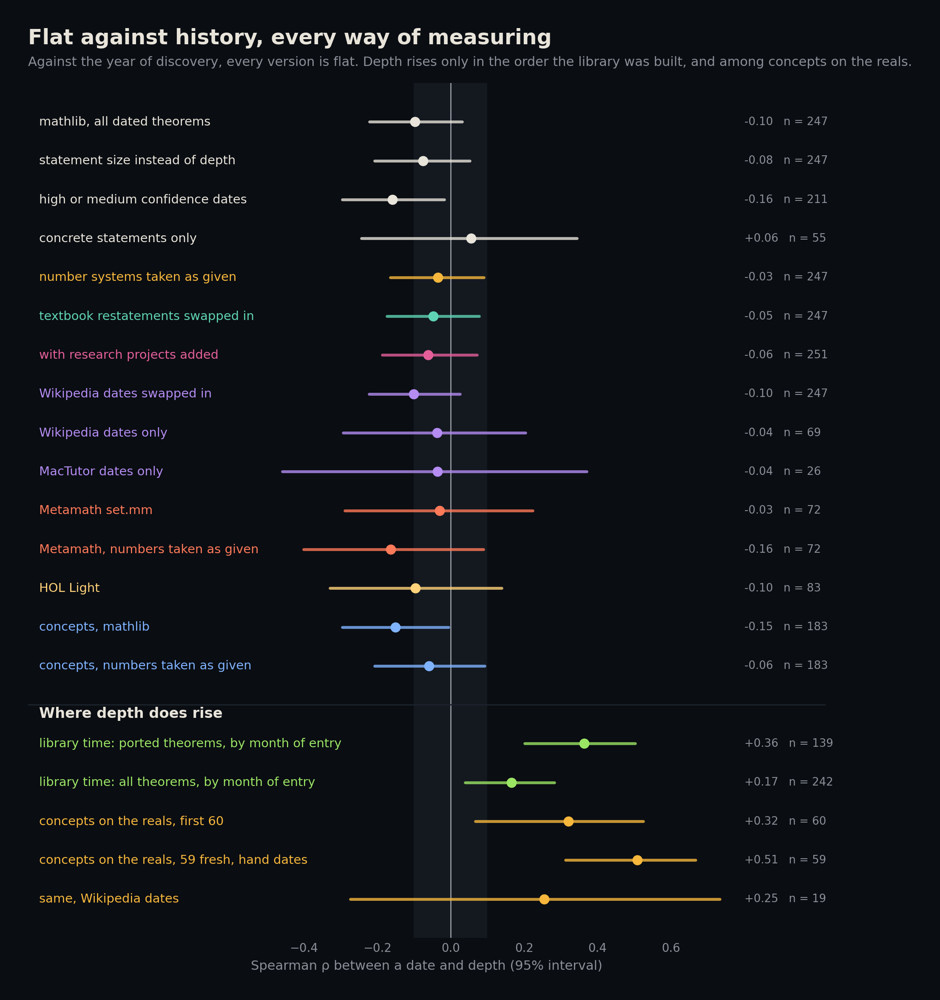
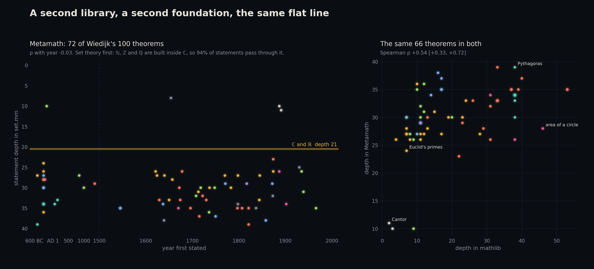
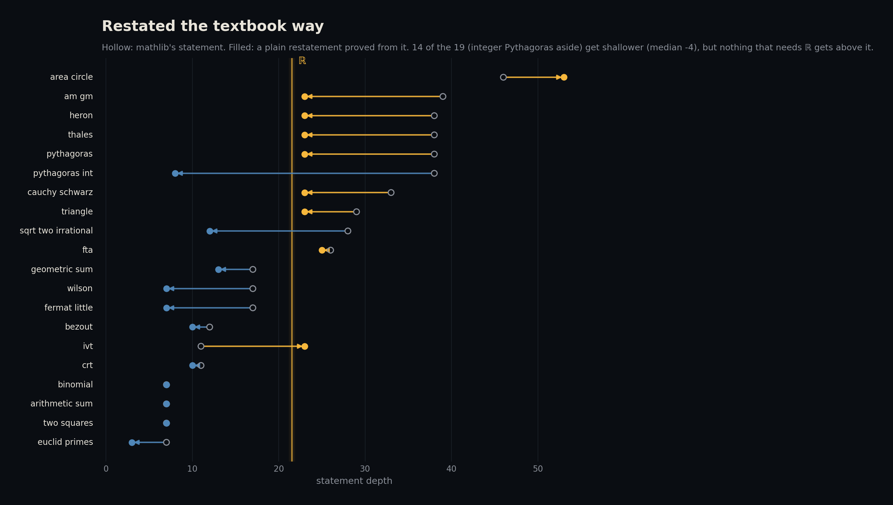
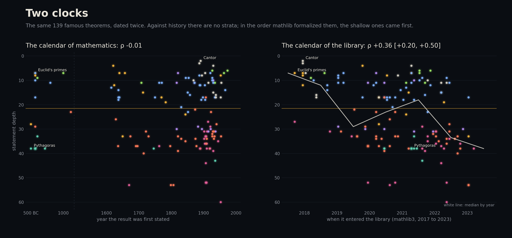
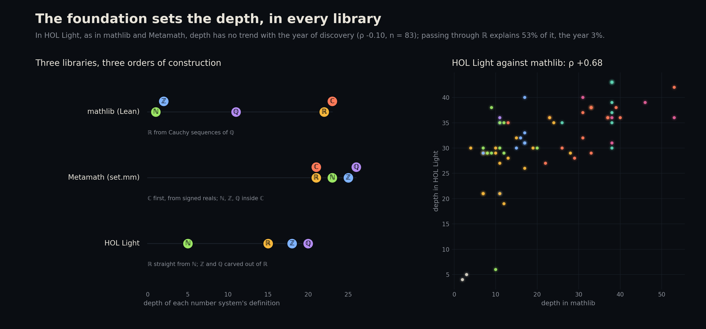

# Strata of Mathematics

**Do newer theorems stand on more mathematics?**

Economists call it the burden of knowledge: the frontier moves outward, so each new discovery needs more prior knowledge than the last. Benjamin Jones measured it in patents through team sizes and the age of first invention. Mathematics seems the cleanest case. Euclid needed whole numbers. Grothendieck needed schemes, sheaves and categories.

A formal library lets you count it exactly. Lean's mathlib proves about 300,000 named theorems, and every definition in it can be followed all the way down to the axioms. This project takes the 250 famous theorems that mathlib links to Lean code, dates each one, and measures how much mathematics its statement stands on: the longest chain of definitions you must unfold to read it.

The hypothesis was that newer theorems sit deeper. Against the history of mathematics they do not: what sets a statement's depth is whether it passes through the real numbers, in mathlib and in two other libraries. Against the history of the library itself, they do: mathlib formalized the shallow theorems first.



An [interactive version](docs/index.html) shows, for any theorem, the chain of definitions under its statement and the famous theorems its proof rests on.

## What it finds

- **The hypothesis fails.** Across 247 dated theorems, Spearman's ρ between the year a result was first stated and the depth of its statement is −0.10 (95% CI −0.22 to 0.03). Results from before 1500 have a median depth of 29; results from 1950 on have 13.5. No version of the test turns positive. Two versions come out slightly negative: high and medium confidence dates only, and theorems from 1800 on.
- **Depth follows the real numbers.** In mathlib, ℝ is built from Cauchy sequences of rationals and sits 22 definitions deep. Whether a statement passes through ℝ explains 78% of the variation in depth. Adding measures and inner products takes it to 89%. The year explains 0.3%. Every famous statement that avoids ℝ is at most 21 deep, and every one that uses ℝ is at least 22. That split is partly built in, since a statement that mentions ℝ inherits ℝ's depth. The informative part is that statements avoiding ℝ almost never get that deep, and that the year does not predict which side a theorem falls on (ρ −0.08). Within each side there is no trend with time (−0.02 without ℝ, −0.11 with).
- **The whole library splits the same way.** Of 300,498 named theorems, 18% pass through ℝ. Their median depth is 35, against 11 for the rest, and 91% of the rest are shallower than ℝ itself.
- **Old concepts are not shallow either.** For 183 core definitions, depth falls slightly with the year the concept appeared (ρ −0.15, CI −0.30 to −0.01). A category (1945) is 3 deep, a topological space (1914) 4, a set (1874) 1. The real numbers, in use since the 16th century, are 22 deep, and an angle is 37. Abstraction resets depth: the newest structures are defined on bare sets. The one exception is the concepts built on ℝ, where newer ones do sit deeper (ρ +0.32, CI 0.07 to 0.52, n = 60). Lebesgue measure (1901) is 32 deep, Lp spaces (1910) 44, conditional expectation (1933) 59 and martingales (1939) 60. This is the only place the burden-of-knowledge pattern appears, and it turned up after the main test had failed.
- **Time runs backwards in mathlib's proofs.** 164 of the famous theorems have proofs that rest on another famous theorem in the sample, and 58% of those rest on one found later. Before 1800 this is about as common as if prerequisites had been picked without regard to history (88% against 96% for 1500 to 1799). For 20th-century theorems mathlib mostly follows history (34% against 71% for 1900 to 1949). Archimedes' area of a circle rests on 21 famous theorems in the sample, 19 of them found later, among them Lebesgue's integral (1902) and Tychonoff's theorem (1930).
- **Deep statements need big proofs.** Statement depth and proof size go together (ρ +0.78). Number theory is the exception: shallow statements whose proofs run through analysis. Bertrand's postulate is 7 deep, but its proof rests on 16,338 definitions and theorems, more than twice the median of 7,428.
- **The flat line survives every follow-up test** (see [below](#six-follow-up-tests)). It holds with the number systems taken as given, in two other libraries built on other foundations (Metamath and HOL Light), with textbook restatements in place of mathlib's general ones, with research results formalized outside mathlib added, with proof dependencies counted only through proofs, and with dates taken from Wikipedia or MacTutor. Every estimate of the main correlation lies between −0.16 and +0.06.
- **The strata do exist, in the library's own history.** Dated by the month each theorem entered mathlib, deeper statements came later (ρ +0.36 for the 139 traced back to mathlib3), while the same theorems against the year of discovery give −0.01. The burden of knowledge shows up in the order mathematics is formalized, not in the order it was found. This was predicted in advance, as was a third library's flat line. A prediction that undergraduate material would be shallower than graduate material failed: it is deeper, because it leans on ℝ.



## How depth is measured

**Extraction.** A Lean program ([lean/Extract.lean](lean/Extract.lean)) loads mathlib v4.35.0 and writes every constant, all 797,867 of them, with the constants used in its type and in its value. That gives 11.2 million type edges and 19.3 million value edges. For a theorem the type is the statement and the value is the proof. For a definition the value is the body. For an inductive type the value is its constructors.

**What counts.** A *concept* is a definition a mathematician would name: a definition, inductive type, structure or class that is not an instance, projection, constructor, recursor, pattern matcher, auxiliary or private declaration, and is not metaprogramming. Everything else that is not a theorem is *glue*: it passes dependencies through but adds no depth.

**Statement depth** is the longest chain of concepts below the constants in a theorem's statement. The chain follows definitions all the way down and never enters a proof: to read a statement you need its definitions, not the proofs of the lemmas those definitions use. **Statement size** is the number of distinct concepts reached. **Proof depth** and **proof size** do the same over every edge, counting named theorems as well as concepts. Mutually recursive blocks, such as an inductive type and its constructors, count as one step.

Two examples, from the deepest concept down:

- **Euclid's theorem** that there are infinitely many primes is 7 deep: `Nat.Prime > Irreducible > IsUnit > Units > Monoid > NPow > Nat`.
- **The Pythagorean theorem** is 38 deep, because mathlib states it with an angle of π/2: `EuclideanGeometry.angle > InnerProductGeometry.angle > Real.arccos > Real.arcsin > ... > Real.pi > Real.cos > Complex.exp > Real.sqrt > NNReal > CauSeq.Completion.Cauchy > ... > Field > NNRat > Rat > Nat.Coprime > Nat.gcd > ... > Not > False`.

**Two leaks had to be fixed.** Structures whose fields have default tactic proofs (`:= by simp`) store the tactic script as `Lean.Syntax` data inside their type. Counted naively, that made ℚ inherit the depth of Lean's parser and gave `Monoid` a dependency on `Array`. The extractor now strips the script from every `autoParam` before collecting constants. Metaprogramming namespaces (`Lean.*`, `Mathlib.Tactic.*` and similar) are cut from both graphs.

**Checks that could fail** ([tests/test_strata.py](tests/test_strata.py)):

- The number tower comes out in order: ℕ 1, ℤ 2, ℚ 11, ℝ 22, ℂ 23.
- A category sits on `Quiver` and `CategoryStruct` at depth 3.
- After the fix, `Monoid` reaches neither `Lean.Syntax` nor `Array`.
- Depth never increases along an edge.
- Known proof dependencies are present: the fundamental theorem of algebra goes through Liouville's theorem, Sylow through Cauchy's theorem, Rolle through the extreme value theorem.
- A dependency that should not exist is absent: Euclid's primes do not need Fourier inversion.
- Toy graphs with hand-worked answers, cycles included, give the right heights.
- For the follow-ups ([tests/test_extensions.py](tests/test_extensions.py)): with the numbers taken as given, every number system is a leaf and no depth increases; Metamath's construction chain comes out in order; direct-use dependencies are a subset of all dependencies; a restatement over ℝ never sits above ℝ; and the year parser handles BC dates, centuries and lifespans.

## The sample and the dates

mathlib keeps two lists that link famous theorems to Lean declarations: [docs/1000.yaml](data/raw/1000.yaml) (Wikipedia's list of theorems, 1,199 entries, 213 linked) and [docs/100.yaml](data/raw/100.yaml) (Freek Wiedijk's 100 theorems). Theorems from the second list that already appear in the first are dropped. So are three entries that point at another entry's declaration, and induction, which is linked to the type `Nat` rather than to a statement. That leaves 250 theorems. Fourteen of them live in mathlib's `Archive` folder, which the prebuilt cache does not ship, so those files are built separately. When an entry lists several declarations, the first theorem among them stands for it. The smallest depth among them gives the same answer (ρ −0.08).

**Dates were assigned by Claude, an AI model, from general knowledge, before Wikidata was consulted** ([data/labels/hand_dates.csv](data/labels/hand_dates.csv)). Each theorem gets the year it was first stated and the year it was first proved. These differ for results like Fermat's Last Theorem (1637 and 1995) and the fundamental theorem of algebra (1629 and 1799). Statement depth is compared with the first year, proof measures with the second. Each date carries a confidence: 131 high, 80 medium, 36 low. Three theorems could not be dated and are left out.

Wikidata then served as an independent audit ([src/dating.py](src/dating.py)):

- **Recorded discovery dates.** Wikidata has a year-precision "time of discovery" for only 8 of the theorems. All 8 agree within 5 years (median gap 0).
- **Lifetimes.** For 135 theorems, Wikidata names a discoverer or namesake with known dates. In 97% of these, the assigned date falls within that person's adult life. The misses are explicable: Bayes' theorem and Viète's formulas were published after their authors died, Wikidata credits the intermediate value theorem to Darboux, and Beatty's theorem was first found by Rayleigh.

Two automatic sources, Wikipedia and MacTutor, were added later as a fuller check (test 6 below).

The 183 concept dates ([data/labels/concept_dates.csv](data/labels/concept_dates.csv)) were made the same way and are fuzzier. When did the real numbers appear? This uses Stevin's decimals (1585) rather than Dedekind's construction (1872). No external audit covers the concepts.

## How sure

**The main test, varied** (Spearman ρ between year and statement depth, with 95% bootstrap intervals):

| Variant | n | ρ |
|---|---|---|
| All dated theorems | 247 | −0.10 [−0.22, 0.03] |
| Statement size in place of depth | 247 | −0.08 [−0.21, 0.05] |
| Smallest depth among the listed declarations | 247 | −0.08 [−0.22, 0.05] |
| Year first proved | 247 | −0.11 [−0.24, 0.01] |
| Concrete statements only (no type or instance arguments) | 55 | +0.06 [−0.24, 0.34] |
| Without geometry | 232 | −0.01 [−0.14, 0.12] |
| High or medium confidence dates only | 211 | −0.16 [−0.29, −0.02] |
| Wikipedia list only | 211 | −0.11 [−0.25, 0.03] |
| From 1800 on | 171 | −0.15 [−0.30, 0.01] |

The concrete-only row tests whether mathlib's habit of stating old results in great generality hides a trend. It does not.

**Within fields** the picture is mixed:

| Field | n | Median depth | ρ with year |
|---|---|---|---|
| Measure and probability | 35 | 38 | −0.13 |
| Geometry | 15 | 38 | −0.11 |
| Analysis | 54 | 34 | −0.16 |
| Topology | 15 | 29 | +0.34 |
| Algebra | 53 | 15 | −0.05 |
| Number theory | 29 | 15 | +0.33 (p = 0.08) |
| Combinatorics | 26 | 11 | +0.10 |
| Logic and foundations | 20 | 9 | +0.56 (p = 0.01) |

Logic is the only field below p = 0.05. With eight fields tested, it does not survive a Bonferroni correction (0.05 / 8 ≈ 0.006). Holding field fixed, the slope is +0.12 levels per century (CI −0.05 to 0.30).

**Time running backwards.** Shuffling dates among the theorems 2,000 times gives the share of dependencies that would point to a younger theorem by chance. It is 50% (37% to 62%), against 40% observed (p ≈ 0.07). So across the whole sample, mathlib's logical order barely beats random with respect to history. The era comparison uses a different null: each theorem keeps its number of famous prerequisites, but they are drawn at random from the other dated theorems. It is shown in [figures/arrow.png](figures/arrow.png).







## Six follow-up tests

The first version left six obvious objections open. Each was tested afterwards, and none changes the answer. Every estimate of the main test is on one chart:



### 1. Take the number systems as given

Textbooks do not build ℝ before using it. [src/variants.py](src/variants.py) cuts the construction files of ℕ, ℤ, ℚ, ℚ≥0, ℝ, ℝ≥0, [0, ∞] and ℂ out of the graph, so each number system becomes a single leaf, and measures again. Statement depth now counts the layers built on top of the numbers. ℝ drops to 1, a metric space from 29 to 12, a measure from 31 to 17, a martingale from 60 to 45, and a scheme stays at 26. The median famous statement goes from 21 deep to 14.

The year still predicts nothing: ρ −0.03 (CI −0.16 to 0.09). The era medians are flat (13, 15, 16, 14, 13 from before 1500 to after 1950). The ℝ split weakens, as it should once ℝ costs one step: using ℝ now explains 42% of depth, and ℝ with measures and inner products 74%. The year explains 0.0%. The one positive pattern survives too: among concepts built on ℝ, newer ones are still deeper (ρ +0.35, CI 0.09 to 0.57, n = 60).

### 2. A second library: Metamath

[Metamath's set.mm](https://github.com/metamath/set.mm) is built on plain ZFC set theory and constructs ℝ from Dedekind cuts. It has no types, so [src/metamath.py](src/metamath.py) rebuilds the measures from its own pieces. A construct is a syntax axiom. A definition is a `df-` axiom, and it defines the newest construct appearing in it. A statement's depth is the longest chain of constructs below the symbols it uses. The construction chain comes out in order: ordinals 8, positive integers 9, positive fractions 15, positive reals 17, signed reals 20, ℝ and ℂ 21. In set.mm, unlike mathlib, ℕ (23), ℤ (25) and ℚ (26) are built inside ℂ.

Metamath has formalized 73 of Wiedijk's 100 theorems, and 72 of them are dated:

- **No trend:** ρ −0.03 (CI −0.29 to 0.22), and −0.16 with the numbers taken as given.
- **The foundation sets depth again:** since ℕ lives inside ℂ, 94% of these statements pass through ℂ. That explains 62% of depth; the year explains 0.1%.
- **The libraries partly agree:** for the 66 theorems in both, depth in set.mm and depth in mathlib correlate at ρ +0.54 (CI 0.33 to 0.72), and proof sizes at +0.60.
- **Proofs run backwards even more:** of the 67 theorems whose set.mm proof uses another listed theorem, 93% use a younger one.



### 3. Textbook restatements

mathlib states old results very generally, which could make them artificially deep. [lean/Textbook.lean](lean/Textbook.lean) restates 20 classical theorems the plain way. Pythagoras and Thales use coordinates, Fermat and Wilson use remainders on ℕ, and the intermediate value theorem takes an ε-δ hypothesis. Each restatement is proved from mathlib's own theorem, so it is a faithful consequence.

Leaving out the integer version of Pythagoras, 14 of the 19 get shallower (median change −4), 3 stay the same and 2 get deeper. Pythagoras goes from 38 to 23 with real coordinates, and to 8 with integer coordinates. Thales, Heron and the AM-GM inequality fall from 38 or 39 to 23. Fermat's little theorem and Wilson's theorem drop from 17 to 7. The two that get deeper are telling. The ε-δ intermediate value theorem (23) sits above mathlib's version (11), because mathlib states it for ordered topological spaces without ℝ. And the area of the circle as an integral (53) sits above mathlib's version with area (46). Nothing that needs ℝ gets above ℝ. With the restatements swapped in, the main test gives ρ −0.05 (CI −0.17 to 0.08).



### 4. Research mathematics outside mathlib

The sample has only 28 theorems from 1950 on, and most are short combinatorial statements. Four research results have been formalized in Lean in projects of their own. Each was cloned at a fixed commit ([results/research_versions.csv](results/research_versions.csv)), built with its own Lean toolchain and mathlib, and dumped with the same extractor ([src/research.py](src/research.py)). The reference depths agree across versions (ℕ 1, ℚ 11, ℝ 22, ℂ 23) except in Carleson's older Lean, where core Lean defines gcd one level shallower and ℝ sits at 21. Its depths are shifted up by one to match.

| Theorem | First stated | Proved | Depth | Numbers given | Predicted from ℝ, measures, inner products | Proof depth | Proof size |
|---|---|---|---|---|---|---|---|
| Polynomial Freiman–Ruzsa conjecture | 1999 | 2023 | 39 | 24 | 30 | 262 | 28,606 |
| Sphere packing in 8 dimensions | 2003 | 2016 | 49 | 34 | 50 | 154 | 16,555 (unfinished) |
| Smale's sphere eversion | 1957 | 1957 | 48 | 33 | 39 | 234 | 31,437 |
| Carleson's theorem | 1915 | 1966 | 55 | 40 | 50 | 249 | 34,163 |

All four pass through ℝ, and their statements are deep: only 17 of the 250 sample theorems reach 48. Classical analysis is just as deep, though: the fundamental theorem of calculus is 53 and optional stopping 60.

A model fitted on the sample, using only whether a statement passes through ℝ, measures and inner products, predicts sphere packing within one level. PFR, sphere eversion and Carleson sit 5 to 9 levels deeper than predicted. The sample's typical miss is 3.5 levels, and 90% of misses are under 7.5. PFR and sphere eversion go through real powers (`Real.rpow`), a chain the model does not see.

The proofs stand out more than the statements. The three finished proofs have depths of 234, 249 and 262, all above the deepest proof among the 250 famous theorems (231). The sphere-packing proof is still in progress: its main theorem uses `sorry`, so its proof numbers are incomplete, though the statement is final. Adding the four to the main test changes nothing (ρ −0.06, CI −0.19 to 0.07, n = 251).

With four theorems this is a hint at most. Research statements are deep mostly for the reason classical analysis is deep, and three of them somewhat deeper still.

**Correction (second round).** The first version of this section suggested the burden of knowledge "may live in proofs, not statements". The second round tested that against a rule written down in advance, and the claim is withdrawn (test 1 below). The research proofs are not deep because of their own arguments: only 23, 29 and 46 layers of their longest chains sit inside the projects. The rest is mathlib underneath them, and in two of the three that library part (206 and 204 layers) is within the range of the sample's own proofs. Inside the sample, how far a proof goes beyond its statement has no trend with the year (ρ −0.04), and the deepest sample proofs are 19th-century number theory.

### 5. Count only direct use in proofs

The backwards-time result counted every route through the library, including definitions: Archimedes reaches Tychonoff through the *construction* of Haar measure. [src/variants.py](src/variants.py) also recounts the famous-theorem dependencies through proof terms alone, from theorem to theorem, never through a definition. In Lean, instances of Prop-valued classes are theorems, so they still count. That leaves 940 of the 1,481 dependencies, and the pattern barely moves. 57% of the theorems that use another famous theorem use a younger one (58% before). The share of dependencies pointing forward is 36% against 49% by chance (p = 0.02). The era pattern is unchanged: before 1800 the proofs are as history-blind as random picks, while in the 20th century they mostly follow history (27% against 62%). Archimedes still reaches Tychonoff, through lemmas alone.

### 6. Independent dates

[src/dating2.py](src/dating2.py) dates the theorems twice more, automatically and without seeing the hand dates:

- **Wikipedia:** the earliest year in a sentence of the article's opening section saying that something was proved, stated or discovered. Lifespans and formulas are stripped first.
- **MacTutor:** the [MacTutor chronology](https://mathshistory.st-andrews.ac.uk/Chronology/) (39 pages, about 2,000 dated events), matched by the theorem's name or its namesake plus a topic word.

| Source | Theorems | Median gap | Within 10 years | Within 50 years | ρ with hand dates |
|---|---|---|---|---|---|
| Wikipedia opening section, article linked by Wikidata | 69 | 0 | 83% | 96% | 0.98 |
| Wikipedia opening section, any article | 82 | 0 | 76% | 93% | 0.97 |
| MacTutor chronology | 26 | 4 | 65% | 73% | 0.85 |

The 13 disagreements of more than 50 years were read one by one ([data/labels/dating_disagreements.csv](data/labels/dating_disagreements.csv)). Seven are errors in the automatic source: a worked example's number, the wrong article, Bombieri's mean value theorem matched to Lagrange's. Four are a different version of the result (Weierstrass 1885 against Stone 1937). Two are earlier partial results (Madhava before Leibniz, d'Alembert's attempt at the fundamental theorem of algebra). None looked like a wrong hand date. The main test with Wikipedia's dates swapped in gives ρ −0.10. With Wikipedia's dates alone it gives −0.04 (n = 69), and with MacTutor's alone −0.04 (n = 26).

## Second round: five more tests, predicted in advance

The predictions for this round were written down before any of its data was collected ([results/preregistration.md](results/preregistration.md), 2026-10-16 16:41 UTC). Two failed, one passed only on dates that were not blind, and two passed.

| | Prediction | Result | Verdict |
|---|---|---|---|
| 1 | Research proofs are deeper than the sample's even counted like for like | Their own developments add 23 to 46 layers, within the sample's range; the library under them adds 204 to 240, above the sample only for PFR | Failed: the claim is withdrawn |
| 2 | Undergraduate material is shallower than graduate material | The reverse: median depth 20 against 13 | Failed |
| 3 | Among new concepts built on ℝ, newer ones are deeper | ρ +0.51 with hand dates; +0.25 (not significant) with the few usable Wikipedia dates | Holds, but not blind |
| 4 | Depth rises with the month a theorem entered mathlib | ρ +0.36 for theorems traced to mathlib3, +0.17 for all; 0.26 to 0.37 above the same theorems against history | Holds |
| 5 | HOL Light builds ℤ inside ℝ with no ℚ layer, shows no trend with year, is explained by ℝ more than by year, and agrees with mathlib | All four | Holds |

### 1. Where research proofs get their depth

[src/proofsplit.py](src/proofsplit.py) follows each proof's longest chain and counts how many of its layers sit inside the theorem's own development. For a research project that is every file outside mathlib. For a theorem in mathlib it is the folder its file sits in, and more generously the folder above. The research graphs had been deleted to save space, so the three finished projects were rebuilt at the same commits.

| Proof | Layers on its longest chain | Inside its own development | In the library underneath |
|---|---|---|---|
| Polynomial Freiman–Ruzsa conjecture | 263 | 23 | 240 |
| Carleson's theorem | 250 | 46 | 204 |
| Smale's sphere eversion | 235 | 29 | 206 |
| Dirichlet's unit theorem, the deepest in the sample | 232 | 25 | 207 |
| Median of the 249 sample proofs | 91 | 13 | |

The projects' own arguments are not unusually long: 23 to 46 layers, while the sample's own developments reach 158. Their depth comes from the mathlib beneath them, and only PFR's library part (240) exceeds the deepest library part in the sample (211). By the rule set in advance, the claim that the burden of knowledge lives in proofs is withdrawn.

### 2. Depth does not follow the syllabus either

[src/syllabus.py](src/syllabus.py) compares the 370 entries of mathlib's undergraduate curriculum with the 325 entries found only in its wider overview. The prediction was that undergraduate material sits shallower. It sits deeper: median 20 against 13 (p < 0.001 in the other direction). Undergraduate courses lean on the real numbers (48% of entries pass through ℝ, against 32%), and the overview's graduate topics are often abstract structures built on bare sets. Undergraduate topology means metric spaces on ℝ (median depth 29); the overview's topology is general topology (11). Within each stratum the difference is small: 11 against 9.5 without ℝ, and 35 against 40 with ℝ, the predicted direction but not significant (p = 0.08). Depth follows neither the calendar nor the syllabus.

### 3. Concepts on the reals, on fresh data

[src/concepts2.py](src/concepts2.py) takes every concept in mathlib's two lists that was not among the first 183, minus a rule fixed in advance (no data structures, nothing named a theorem, isomorphism, existence, equivalence, correspondence or formula). That leaves 215, of which 59 pass through ℝ.

The planned blind dating failed. Wikipedia gave a year for only 19 of the 59, and most of those came from the wrong article ("tangent map" landed on hyperbolic functions, "Lp functions" on p-adic L-functions). With those dates, ρ is +0.25 (CI −0.27 to 0.73). The fallback was hand dates ([data/labels/concept_dates_fresh.csv](data/labels/concept_dates_fresh.csv)). They are not blind, because these concepts' depths had been printed during the first round. With them, ρ is +0.51 (CI 0.31 to 0.67), +0.55 for the 27 high- and medium-confidence dates, and +0.41 (CI 0.26 to 0.55) pooled with the first 60. Inside analysis on ℝ, newer concepts sit deeper: the burden of knowledge in its plainest form, and the one place it shows against history. Because the blind version could not be run, it should be counted as likely, not settled.

### 4. Library time: the strata appear in the order mathlib was built

[src/library_time.py](src/library_time.py) dates each theorem and concept by the first month it existed in mathlib.
- **Snapshots:** it searches monthly snapshots of mathlib3 (2017 to 2023) and mathlib4 (2021 to 2026).
- **Port map:** the `#align` lines left by the port map 131,038 Lean 4 names back to their Lean 3 originals.
- **Exact names:** a match counts only if its full name, read inside the `namespace` blocks of the file at that commit, is the target's. Short names repeat: mathlib3 also declares `with_zero_topology.topological_space`, and its 2017 `measure` was a field of a different structure. When a declaration only changed namespace inside its file (`zmodp` to `zmod`), the date follows it back.
- **Renames:** names changed after the port are followed through `@[deprecated] alias` lines, read inside their own namespace.
- **Coverage:** 141 theorems trace back to mathlib3. 104 appear only in mathlib4 under their current names, which gives a "no later than" date. 5 are not found.
- **Audit:** [src/library_audit.py](src/library_audit.py) redates a random 30 theorems and 10 concepts commit by commit, from git's own search for the first commit that declares each exact name. 39 of the 40 agree to the month. The other is `legendre_sym.quadratic_reciprocity`, which the snapshots follow back five months to its earlier name `zmod.quadratic_reciprocity`, as intended.

The results:
- **Known answer:** ℝ entered in August 2017, and no statement through ℝ entered before it.
- **Theorems traced to mathlib3:** depth rises with entry date, ρ +0.36 (CI 0.20 to 0.50, n = 139). The same theorems against the year of discovery give −0.01. The difference is +0.37 (CI 0.20 to 0.55).
- **All theorems:** +0.17 (CI 0.04 to 0.28), against −0.10 for history; the difference is +0.26 (CI 0.12 to 0.40).
- **Within each stratum:** among all dated theorems, +0.26 for those that avoid ℝ and +0.25 for those through it, both with intervals above 0. So the rise is not only ℝ-based statements arriving later.
- **Concepts traced to mathlib3:** +0.33 (CI 0.17 to 0.47).
- **The first in:** Euclid's theorem and Carathéodory's theorem in measure theory (September 2017), then Cantor–Bernstein–Schröder, Matiyasevich's theorem, Bézout's identity and Cantor's theorem in December. The median depth of a year's entries was 7 in 2017 and 12 in 2018, and between 17 and 33 in every year since.

Part of this is built in: a statement cannot enter the library before its definitions. ℝ arrived in August 2017, measures in July 2018 and Lp spaces in January 2021, and the share of entries that pass through ℝ went from 11 to 14% in 2017 and 2018 to between 32 and 72% in every later year. Still, it locates the burden of knowledge. It is real in the order mathematics gets *formalized*, and the order it was *discovered* leaves no trace of it.



### 5. A third library: HOL Light

[src/hollight.py](src/hollight.py) reads [HOL Light](https://github.com/jrh13/hol-light)'s OCaml scripts as text, in HOL Light's own load order, and rebuilds its definitional graph. HOL Light resolves symbols such as `+` by type inference, which a text reader cannot do. So the parser replays HOL Light's interface commands (`make_overloadable`, `overload_interface`, `override_interface`, `prioritize_real()`) and picks the meaning a definition's name suggests (`real_` constants use real addition), else the active priority, else the most recently declared one. The construction comes out as predicted:
- **ℕ** is 5 deep.
- **"Nearly additive" functions** are 11 deep, and **positive reals** 13.
- **ℝ** is 15 deep, with no ℚ layer.
- **ℤ** is 18 deep, carved out of ℝ.
- **Rationality** is a predicate on ℝ, at 20.

Wiedijk's HOL Light page gives 84 statements, and 83 are dated:
- **No trend:** ρ −0.10 (CI −0.31 to 0.14).
- **ℝ explains 53% of depth,** the year 3%. 95% of the statements pass through ℝ: even primes do, because divisibility on ℕ is defined through ℤ, which lives inside ℝ.
- **The libraries agree:** for the 68 theorems also in the mathlib sample, depth correlates at ρ +0.68 (CI 0.51 to 0.79); against Metamath it is +0.47.
- **The same extremes:** the shallowest statements are Cantor's theorem (4) and Schröder–Bernstein (5), the deepest the geometry stated with angles (43), as in mathlib.



## What this does not show

- **Depth depends on the library.** mathlib's design choices show: every field carries a cast from the non-negative rationals, which is why a field (17) sits deeper than ℚ (11). Metamath puts ℕ inside ℂ, so there almost everything passes through ℂ. The two libraries rank the same theorems only moderately alike (ρ +0.54). What carries over is the absence of a time trend and the dominance of the number-system foundation, not the individual numbers.
- **"Rests on" means a logical dependency inside mathlib**, through the whole library. It does not mean the textbook proof uses it. Archimedes did not need Tychonoff's theorem. mathlib's proof that area on the plane is a Haar measure goes through Haar's general construction, which does.
- **Only the listed declaration counts as a famous theorem.** A proof that uses a sibling lemma is missed. The mean value theorem uses `exists_hasDerivAt_eq_zero`, a version of Rolle's theorem, while mathlib's list names `exists_deriv_eq_zero`. The dependency counts are therefore lower bounds.
- **The sample is the theorems mathlib links.** It leans toward undergraduate classics. Research mathematics of the last 60 years is thin: 28 theorems from 1950 on, plus the research projects in test 4. The library-wide histogram covers the rest of mathlib, undated.
- **Dates are judgment calls**, most of all for ancient results and for concepts. Two automatic sources agree closely with the theorem dates, but nothing external checks the concept dates.
- **Some findings were not predicted.** The split at ℝ and the backwards proofs were found after the main test failed. The rise of ℝ-based concepts was then predicted in advance and held on fresh concepts, but only with dates that were not blind. The layering in library time was predicted in advance and held.
- **Library dates measure when a name appeared, by month.** 104 theorems are dated only from mathlib4, under their current names, so their dates are upper bounds. Groups and fields date from 2020, when mathlib took them over from Lean 3's core library, not from when Lean first had them.
- **The HOL Light numbers come from reading OCaml as text.** HOL Light picks the meaning of an overloaded symbol by type inference, and the parser approximates that. The construction chain comes out exactly as HOL Light's sources describe it, which is the check that it works.

## Reproduce

Needs [elan](https://github.com/leanprover/elan), Python 3.11 or later, about 11 GB of disk (mathlib's build cache 6.7 GB, the Lean toolchain 3.2 GB) and 6 GB of RAM.

```bash
cd lean && lake update
```

That fetches mathlib v4.35.0 and unpacks its prebuilt build cache.

```bash
cd lean && lake build $(cat ../results/archive_modules.txt) extract
```

```bash
cd lean && lake exe extract ../data/derived/graph Mathlib $(cat ../results/archive_modules.txt)
```

The extraction takes about 5 minutes and writes about 480 MB of TSV.

```bash
pip install -r requirements.txt
```

```bash
cd src && python run_all.py
```

```bash
cd src && python report.py
```

```bash
pytest tests
```

`run_all.py wikidata` skips the Wikidata query and reuses the saved pull in `data/raw/wikidata.json`. `report.py` prints every number in this README.

**The follow-up tests** need a few more steps:

1. Download set.mm and the Metamath 100-theorems page (51 MB):

```bash
curl -L -o data/raw/metamath/set.mm https://raw.githubusercontent.com/metamath/set.mm/7b308bd7c2cb5bdf70c6f4070eb7dbcd00d5bc12/set.mm
```

```bash
curl -L -o data/raw/metamath/mm_100.html https://us.metamath.org/mm_100.html
```

2. Compile the textbook restatements against the same mathlib, then list what they use (on Linux and macOS, join the paths with `:` instead of `;`):

```bash
cd lean && LEAN_PATH="$(lake env printenv LEAN_PATH);../data/derived/lean_build" lean -o ../data/derived/lean_build/Textbook.olean Textbook.lean
```

```bash
cd lean && LEAN_PATH="$(lake env printenv LEAN_PATH);../data/derived/lean_build" lean --run ExtractNames.lean Textbook Mathlib Textbook > ../data/derived/textbook_edges.tsv
```

3. Each research project needs its own toolchain and mathlib, about 10 GB at a time; `source lean/research_env.sh` keeps all of it inside the project folder. Clone the project under `research/<name>` at the commit in [results/research_versions.csv](results/research_versions.csv), run `lake exe cache get`, add `lean/Extract.lean` as an executable (with `import Mathlib.Init` on its first line when the project's lakefile switches on a mathlib linter option), build the module named in `src/research.py`, and run `lake exe extract ../../data/derived/research/<name>/graph <module>`. Then:

```bash
cd src && python research.py pfr
```

4. Run the analyses (the MacTutor and Wikipedia step needs the network):

```bash
cd src && python variants.py && python dating2.py && python textbook.py && python metamath.py && python extensions.py && python figures_ext.py
```

**The second round** needs the git histories of mathlib3, mathlib4 and HOL Light (about 0.9 GB) cloned under `history/`, and Wiedijk's HOL Light page:

```bash
git clone --no-checkout https://github.com/leanprover-community/mathlib3.git history/mathlib3
```

```bash
git clone --no-checkout https://github.com/leanprover-community/mathlib4.git history/mathlib4
```

```bash
git clone https://github.com/jrh13/hol-light.git history/hol-light
```

```bash
curl -L -o data/raw/hol-light/freek_hol.html https://www.cs.ru.nl/~freek/100/hol.html
```

`bash lean/build_research.sh <name> <repo> <commit> <module>` rebuilds one research project at the commit in [results/research_versions.csv](results/research_versions.csv) (pass `Mathlib.Init` as a fifth argument for sphere eversion and Carleson). Then:

```bash
cd src && python proofsplit.py && python syllabus.py && python concepts2.py && python library_time.py && python library_audit.py && python hollight.py && python round2.py && python figures_round2.py
```

## Files

| Path | What |
|---|---|
| `lean/Extract.lean` | dumps the dependency graph of any Lean environment |
| `src/graph.py` | node classes, statement and proof graphs, heights, reachability |
| `src/targets.py` | famous theorems and their declarations |
| `src/measures.py` | statement and proof measures, famous-theorem dependencies, field labels |
| `src/wikidata.py`, `src/dating.py` | Wikidata pull and the dating audit |
| `src/concepts.py`, `src/chains.py` | concept depths, deepest chains |
| `src/analysis.py`, `src/report.py` | statistics and the numbers in this README |
| `src/figures.py`, `src/webpage.py` | figures and `docs/index.html` |
| `src/variants.py` | number systems taken as given; direct-use dependencies |
| `src/metamath.py` | parser and measures for Metamath's set.mm |
| `lean/Textbook.lean`, `lean/ExtractNames.lean`, `src/textbook.py` | textbook restatements and their depths |
| `src/research.py` | research projects outside mathlib |
| `src/dating2.py` | Wikipedia and MacTutor dates |
| `src/extensions.py`, `src/figures_ext.py` | statistics and figures for the follow-up tests |
| `results/preregistration.md` | the second round's predictions, written before its data |
| `src/proofsplit.py` | own-development and library layers on each proof's longest chain |
| `src/syllabus.py`, `src/concepts2.py` | the syllabus test and the fresh concepts |
| `src/library_time.py`, `src/library_audit.py` | when each theorem and concept entered mathlib, from git history, and a commit-level check of those dates |
| `src/hollight.py` | text reader and measures for HOL Light |
| `src/round2.py`, `src/figures_round2.py` | statistics and figures for the second round |
| `lean/build_research.sh`, `lean/research_env.sh` | rebuild a research project with everything kept in `tools/` |
| `data/labels/` | hand-made dates for theorems and concepts, and the classified dating disagreements |
| `data/derived/theorems.csv` | one row per theorem with every measure and date |

## Credits

The [mathlib](https://github.com/leanprover-community/mathlib4) community wrote the library and maintains the theorem lists (Apache 2.0). The 100-theorems list is [Freek Wiedijk's](https://www.cs.ru.nl/~freek/100/). Dating evidence comes from [Wikidata](https://www.wikidata.org) (CC0), Wikipedia (CC BY-SA) and the [MacTutor History of Mathematics](https://mathshistory.st-andrews.ac.uk/) chronology. The Metamath database [set.mm](https://github.com/metamath/set.mm) is public domain (CC0). The research formalizations belong to their authors: [PFR](https://github.com/teorth/pfr), [Sphere Packing](https://github.com/thefundamentaltheor3m/Sphere-Packing-Lean), [sphere eversion](https://github.com/leanprover-community/sphere-eversion) and [Carleson](https://github.com/fpvandoorn/carleson). [HOL Light](https://github.com/jrh13/hol-light) is by John Harrison and contributors (BSD-style licence). Library history comes from the [mathlib3](https://github.com/leanprover-community/mathlib3) and [mathlib4](https://github.com/leanprover-community/mathlib4) repositories. The idea of a burden of knowledge is from Benjamin F. Jones, "The Burden of Knowledge and the Death of the Renaissance Man" (Review of Economic Studies, 2009).
